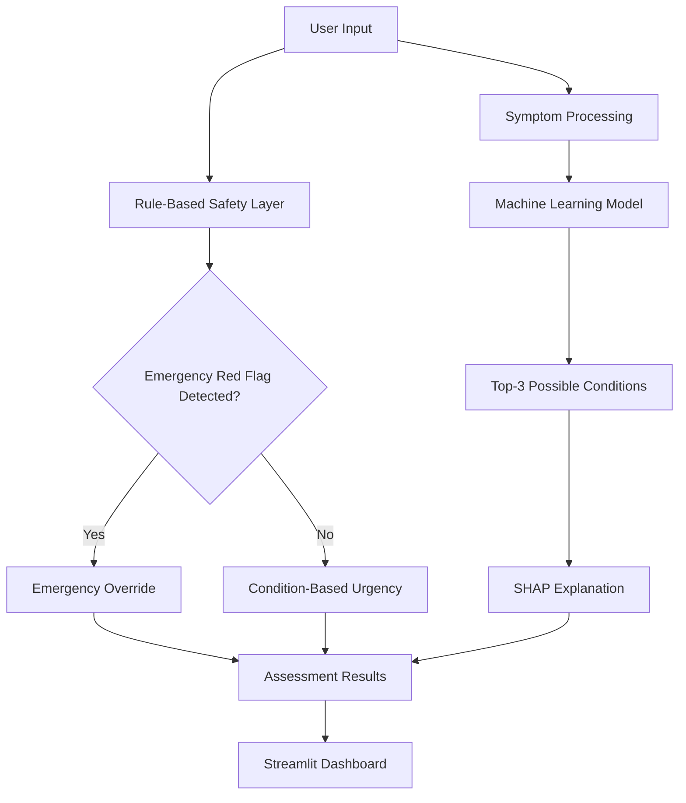

# SmartHealth Triage
[](https://www.python.org/)
[](https://streamlit.io/)
[](https://scikit-learn.org/)
[](https://github.com/slundberg/shap)
[]()

**Explainable Symptom-Based Health Issue Prediction and Risk Stratification System**

SmartHealth Triage is an academic MCA Data Science project that explores how machine learning, explainable AI, and rule-based safety checks can be combined in a symptom-assessment application.

The system predicts possible health conditions from user-reported symptoms, checks for predefined emergency warning signs, and provides explanations of model predictions using SHAP.

> **Important:** This is an educational prototype, not a clinically validated medical diagnostic system. Its predictions and urgency assessments must not replace professional medical advice.

---

## Project Overview

Traditional machine learning classifiers focus mainly on predicting a target class from input features. In symptom-assessment applications, however, predicting a possible condition is only one part of the problem. Emergency warning signs and the urgency of seeking medical attention also need consideration.

SmartHealth Triage explores this problem through three main components:

1. **Machine Learning Prediction:** Uses a trained classification model to identify and rank up to three possible health conditions based on reported symptoms.
2. **Rule-Based Safety Layer:** Checks configured emergency red flags and can override the normal urgency assessment when a recognised warning sign is detected.
3. **Explainable AI:** Uses SHAP to show which symptom features contributed to the model prediction.

The project uses an artificially generated symptom-and-disease dataset. Its results should not be interpreted as evidence of clinical accuracy or real-world medical effectiveness.

---

## Key Features

- Symptom selection using a vocabulary of 178 model features.
- Top-3 possible health-condition predictions.
- Rule-based emergency red-flag detection.
- Separate safety override mechanism.
- Four urgency categories: LOW, MODERATE, HIGH, and EMERGENCY.
- SHAP-based explanations of model predictions.
- Interactive Streamlit dashboard.
- Modular Python implementation.

---

## System Architecture



### Main Components

| Component | Responsibility |
|---|---|
| Input Processing | Converts reported symptoms into model features. |
| ML Inference | Generates possible-condition predictions. |
| Safety Layer | Checks predefined emergency warning signs. |
| Urgency Assessment | Determines the displayed urgency category. |
| SHAP Explainability | Explains feature contributions to model predictions. |
| Streamlit Interface | Displays inputs, predictions, alerts, and explanations. |

---

## Technology Stack

| Technology | Purpose |
|---|---|
| Python | Main programming language |
| Pandas | Data handling and preprocessing |
| NumPy | Numerical operations |
| Scikit-learn | Machine learning |
| SHAP | Explainable AI |
| Streamlit | Interactive web application |
| Altair | Data visualisation |
| Joblib | Model loading and storage |
| PyArrow | Parquet dataset support |

---

## Repository Structure

```text
SmartHealthTriage/
│
├── app/
│   └── app.py
│
├── src/
│   ├── __init__.py
│   ├── inference.py
│   ├── safety_layer.py
│   └── explainability.py
│
├── models/
│   ├── best_model.joblib
│   ├── random_forest_model.joblib
│   ├── label_encoder.joblib
│   └── shap_test_patient.png
│
├── datasets/
│   ├── symptom_features.txt
│   ├── X_train.parquet
│   ├── X_test.parquet
│   ├── y_train.parquet
│   └── y_test.parquet
│
├── notebooks/
│   ├── 01_dataset_inspection.py
│   ├── 02_data_preprocessing.py
│   ├── 03_model_training.py
│   ├── 04_test_shap.py
│   └── 05_test_safety_layer.py
│
├── main.py
├── requirements.txt
├── README.md
└── REPORT.md
```

---

## Installation and Setup

### 1. Clone the Repository

```bash
git clone https://github.com/niranjanhm21/SmartHealthTriage.git
cd SmartHealthTriage
```

### 2. Create a Virtual Environment (Optional)

```bash
python -m venv venv
```

Activate it on Windows:

```powershell
.\venv\Scripts\Activate.ps1
```

On Linux or macOS:

```bash
source venv/bin/activate
```

### 3. Install Dependencies

```bash
pip install -r requirements.txt
```

### 4. Run the Application

```bash
streamlit run app/app.py
```

Open the local application address shown in the terminal, normally:

```text
http://localhost:8501
```

---

## Safety and Limitations

SmartHealth Triage uses predefined rules to identify selected emergency warning signs. A recognised warning sign can override the normal model-based urgency assessment.

However, the safety layer has important limitations:

- It only checks the warning signs implemented in its rules.
- It cannot guarantee detection of every emergency.
- Unrecognised or unsupported input may not be interpreted correctly.
- The model is trained using artificially generated data.
- Model scores are not medically calibrated probabilities.
- SHAP explanations describe model behaviour, not medical correctness.
- The system has not undergone clinical validation.

The application is intended for academic demonstration and research into explainable symptom assessment.

**Medical Disclaimer:** SmartHealth Triage does not provide confirmed diagnoses, prescribe medication, or replace a qualified healthcare professional. If you experience a possible medical emergency, seek immediate professional help through local emergency services. In India, call **112**.

---

## Future Enhancements

- Adaptive follow-up questions based on reported symptoms.
- Improved dataset quality and independent evaluation.
- More comprehensive red-flag testing.
- Evaluation of under-triage and over-triage.
- Model calibration and uncertainty assessment.
- Additional input features where suitable data is available.
- Improved SHAP visualisations.
- Cloud deployment for academic demonstration.

---

## Academic Purpose

This project was developed as an MCA Data Science academic project to explore the integration of:

- Supervised machine learning.
- Symptom-based condition prediction.
- Rule-based safety mechanisms.
- Explainable artificial intelligence.
- Interactive application development.

The project focuses on demonstrating the technical architecture and evaluation challenges of symptom-assessment systems, rather than claiming clinical effectiveness.

---

## Author

**Niranjan H M**

MCA Student | Data Science

GitHub: [niranjanhm21](https://github.com/niranjanhm21)
