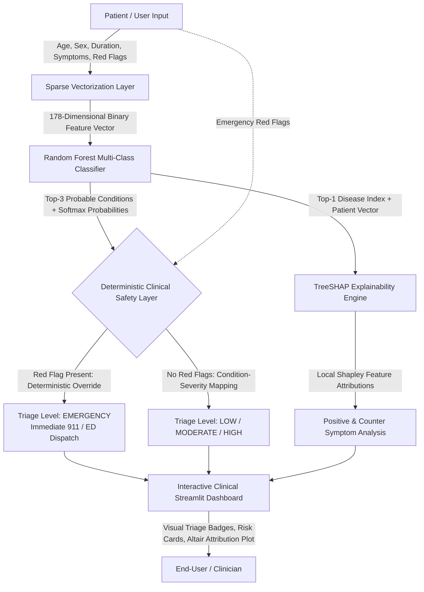

# SmartHealth Triage: Explainable Symptom-Based Health Issue Prediction and Risk Stratification System

[](https://www.python.org/)
[](https://streamlit.io/)
[](https://scikit-learn.org/)
[](https://github.com/slundberg/shap)
[]()

> **Novelty & Core Innovation:**  
> **SmartHealth Triage bridges the gap between black-box statistical symptom checking and emergency patient safety by uniting a high-accuracy Random Forest classifier and real-time TreeSHAP local explainability with a deterministic clinical red-flag override engine that eliminates critical under-triage risks.**

---

## 📌 Project Overview

Digital symptom assessment tools and AI symptom checkers frequently suffer from two fatal vulnerabilities:
1. **Under-Triage Risk**: Statistical models trained on disease prevalence often misclassify critical emergency emergencies (such as myocardial infarction or stroke) as benign conditions when common symptoms overlap.
2. **Opacity (Black-Box Nature)**: Patients and clinicians lack visibility into *why* a particular condition was recommended, eroding trust and clinical utility.

**SmartHealth Triage** addresses both challenges through an explainable, safety-constrained dual-engine architecture:
- **Statistical ML Engine**: Evaluates 178 binary clinical indicators to rank the **Top-3 probable conditions** with calibrated confidence scores across the top 40 clinical disease classes.
- **Deterministic Clinical Safety Layer**: Acts as an uncompromised circuit breaker. If acute emergency red flags (e.g., crushing chest pain radiating to the left arm, acute resting dyspnea, sudden hemiparesis, syncope) are reported, the case is immediately escalated to **EMERGENCY PRIORITY**, superseding statistical predictions.
- **TreeSHAP Explainability**: Decomposes the model's log-odds output to reveal exactly which present symptoms supported the prediction and which absent symptoms argued against it.

---

## 🏛️ High-Level System Architecture



### Architectural Pipeline Breakdown:
1. **User Intake Form**: Captures demographics, symptom duration, self-reported severity, multi-select symptoms from a 178-feature clinical lexicon, and an explicit emergency red-flag checklist.
2. **Sparse Vectorization (`src/inference.py`)**: Encodes reported complaints into an exact 178-dimensional binary vector matching pre-trained feature indices.
3. **ML Inference Engine (`models/best_model.joblib`)**: Runs fast multi-class inference to yield ranked disease predictions and calibrated confidence percentages.
4. **Safety Override Circuit Breaker (`src/safety_layer.py`)**: Evaluates explicit red flags and critical symptom combinations against standardized clinical emergency protocols.
5. **SHAP Feature Attribution (`src/explainability.py`)**: Executes tree-based Shapley value computation ($0.41\text{s}$) to extract top positive and negative contributing features.
6. **Medical-Informatics Web UI (`app/app.py`)**: Renders color-coded urgency badges, high-visibility emergency alert banners, differential diagnosis progress bars, and interactive Altair feature attribution charts.

---

## 🚀 Quick Start & Installation

### 1. Prerequisites
- **Python**: Version 3.10, 3.11, or 3.12
- **Operating System**: Windows, macOS, or Linux

### 2. Clone Repository & Setup Virtual Environment
```bash
# Navigate to the project root directory
cd SmartHealthTriage

# Create a virtual environment (optional but recommended)
python -m venv venv

# Activate the virtual environment
# Windows (PowerShell):
.\venv\Scripts\Activate.ps1
# Linux/macOS:
source venv/bin/activate
```

### 3. Install Dependencies
```bash
pip install -r requirements.txt
```

### 4. Launch the Web Application
```bash
streamlit run app/app.py
```

Once initialized, open your browser and navigate to:
```text
http://localhost:8501
```

---

## 📂 Repository Structure

```text
SmartHealthTriage/
├── app/
│   └── app.py                     # Streamlit clinical dashboard UI
├── src/
│   ├── __init__.py                # Package initializer
│   ├── inference.py               # Unified end-to-end inference pipeline
│   ├── safety_layer.py            # Deterministic clinical safety rule engine
│   └── explainability.py          # TreeSHAP feature attribution module
├── models/
│   ├── best_model.joblib          # Optimized multi-class classifier
│   ├── random_forest_model.joblib # Random Forest ensemble for TreeSHAP
│   ├── label_encoder.joblib       # Label encoder for 40 clinical disease classes
│   └── shap_test_patient.png      # Baseline SHAP test visualization
├── datasets/
│   ├── symptom_features.txt       # Lexicon of 178 active binary symptom features
│   ├── X_train.parquet            # Processed training features (80% split)
│   ├── X_test.parquet             # Processed testing features (20% split)
│   ├── y_train.parquet            # Encoded training labels
│   └── y_test.parquet             # Encoded testing labels
├── notebooks/
│   ├── 01_dataset_inspection.py   # Dataset auditing, sparsity, and distribution analysis
│   ├── 02_data_preprocessing.py   # Deduplication, class filtering (Top 40), and stratified split
│   ├── 03_model_training.py       # Multi-model benchmark (LR vs. RF vs. GBM)
│   ├── 04_test_shap.py            # SHAP explainability verification test
│   └── 05_test_safety_layer.py    # Deterministic safety override unit test
├── requirements.txt               # Locked project dependencies
├── README.md                      # Project documentation and quick-start guide
└── REPORT.md                      # Comprehensive academic MCA mini-project report
```

---

## 🧪 Experimental Verification Scripts

To independently verify system components via command-line test harnesses:

```bash
# 1. Inspect dataset sparsity and column distributions
python notebooks/01_dataset_inspection.py

# 2. Re-run data cleaning and stratified splits
python notebooks/02_data_preprocessing.py

# 3. Verify TreeSHAP local attribution on sample patient vectors
python notebooks/04_test_shap.py

# 4. Verify deterministic clinical safety override rules
python notebooks/05_test_safety_layer.py
```

---

## 🛡️ Clinical & Academic Disclaimer

> **IMPORTANT NOTICE:**  
> **SmartHealth Triage is an academic research prototype developed as an MCA mini-project.**  
> It is designed exclusively for educational, technical demonstration, and decision-support research purposes. It does not provide medical diagnoses, clinical prognoses, or definitive treatment prescriptions. If you or someone you know is experiencing acute medical symptoms, crushing chest pain, severe breathlessness, or neurological impairment, **immediately call local emergency services (911) or proceed to the nearest emergency room.**
